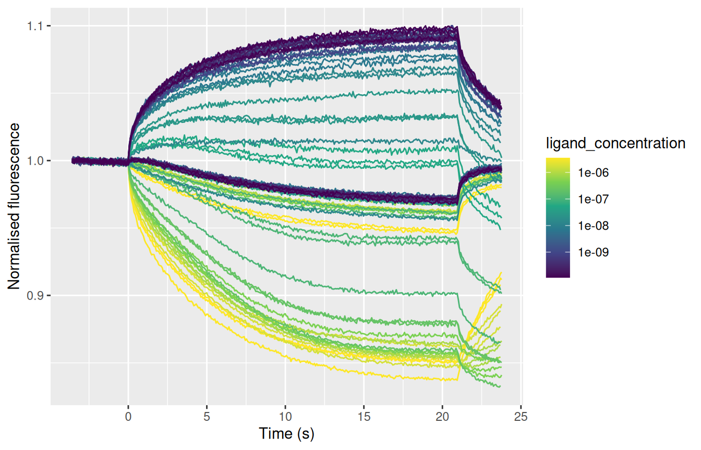
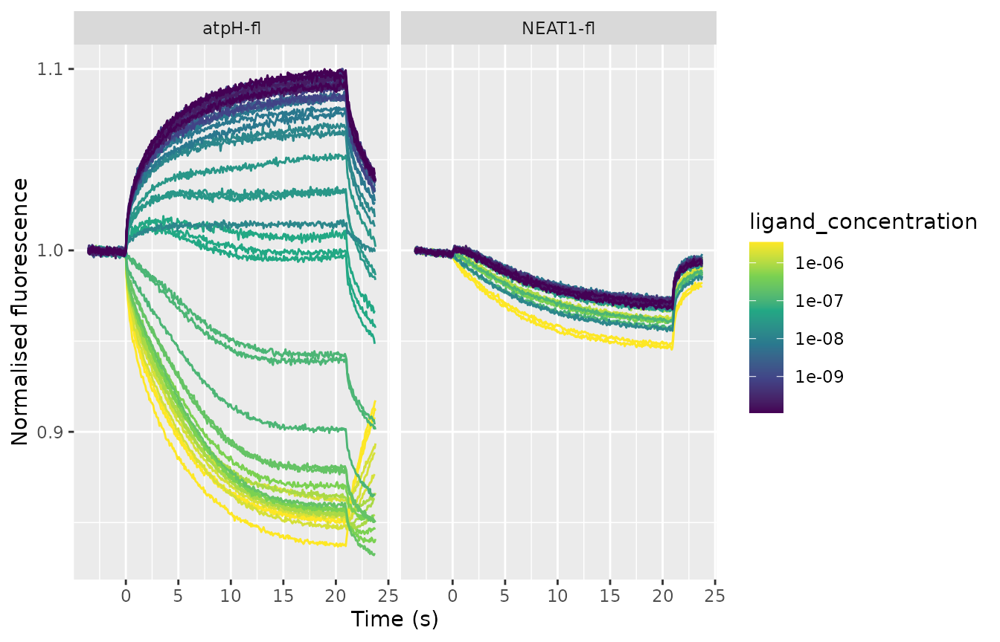
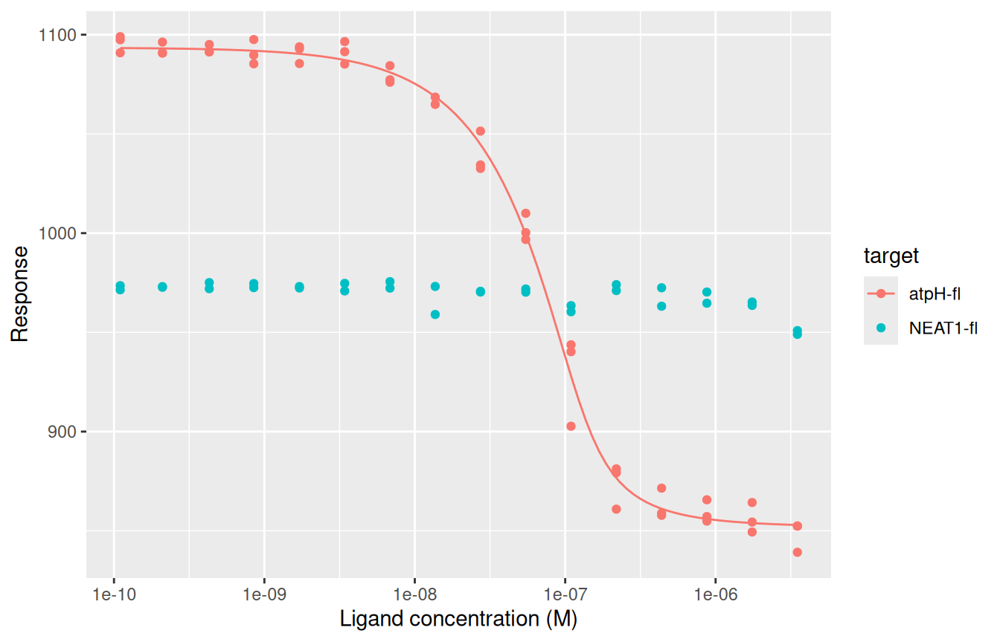
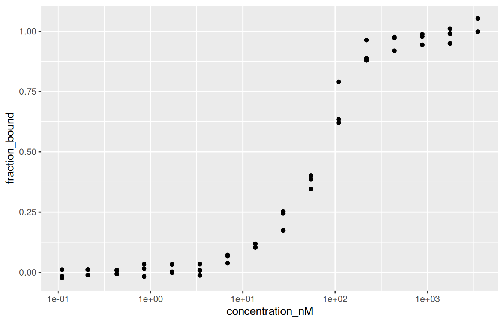
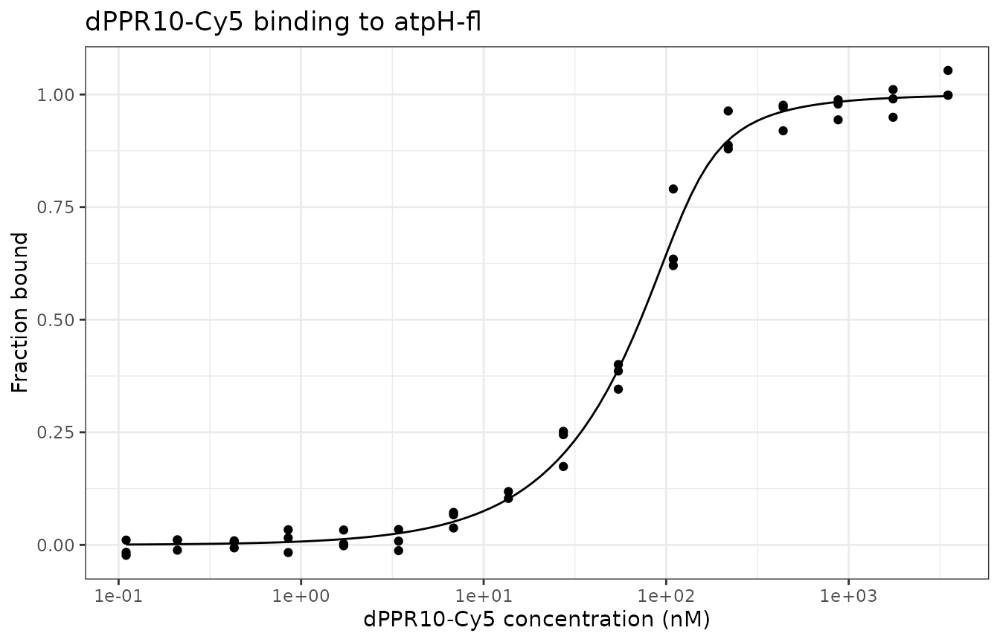
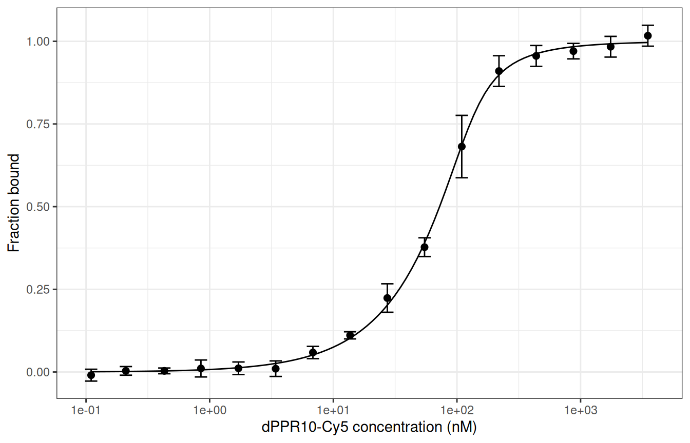

# Get started with tidymst

tidymst reads the Excel files that NanoTemper’s MO.Affinity Analysis
software exports from microscale thermophoresis (MST) experiments, and
turns them into ordinary R data frames. From there you can recalculate
Fnorm, fit binding curves to get a Kd, and make your own plots.

This guide walks through a whole analysis. It assumes you have used R a
little, for example to make a basic plot, but not much more.

## Setup

Install tidymst from GitHub (you only need to do this once):

``` r

install.packages("pak")
pak::pak("BradyAJohnston/tidymst")
```

Then load it at the start of every script, along with dplyr (for working
with data frames) and ggplot2 (for plotting):

``` r

library(tidymst)
library(dplyr)
library(ggplot2)
```

## Exporting your data from MO.Affinity Analysis

tidymst reads the `.xlsx` files that MO.Affinity Analysis writes when
you export data. Which export you need depends on what you want to do:

| To get | Export from | Read with |
|----|----|----|
| The MST trace of every capillary | MST Traces | [`read_mst_traces()`](https://bradyajohnston.github.io/tidymst/reference/read_mst_traces.md) |
| The Fnorm of every capillary | Dose-Response (Flat) | [`read_mst_dose_response()`](https://bradyajohnston.github.io/tidymst/reference/read_mst_dose_response.md) |
| Mean responses, and MO.Affinity’s fit | Compare Results (Chart) | [`read_mst_dose_response()`](https://bradyajohnston.github.io/tidymst/reference/read_mst_dose_response.md), [`read_mst_fit()`](https://bradyajohnston.github.io/tidymst/reference/read_mst_fit.md) |
| A table of MO.Affinity’s fits | Compare Results (Grid) | [`read_mst_fit()`](https://bradyajohnston.github.io/tidymst/reference/read_mst_fit.md) |
| The capillary scans | Capillary Scan | [`read_mst_capillary_scan()`](https://bradyajohnston.github.io/tidymst/reference/read_mst_capillary_scan.md) |

If you’re not sure what a file is,
[`read_mst()`](https://bradyajohnston.github.io/tidymst/reference/read_mst.md)
works it out for you and picks the right reader.

The MST Traces export is the most useful: it has the raw data and
records which capillaries you marked as outliers, so you can redo the
whole analysis in R.

You can also skip exporting altogether and read the project files that
NanoTemper’s software saves, with the same functions:

| To get | `.moc` (MO.Control) | `.nta` (MO.Affinity Analysis) | Read with |
|----|:--:|:--:|----|
| The MST trace of every capillary | ✓ | ✓ | [`read_mst_traces()`](https://bradyajohnston.github.io/tidymst/reference/read_mst_traces.md) |
| The capillary scans | ✓ | ✓ | [`read_mst_capillary_scan()`](https://bradyajohnston.github.io/tidymst/reference/read_mst_capillary_scan.md) |
| The Fnorm of every capillary |  | ✓ | [`read_mst_dose_response()`](https://bradyajohnston.github.io/tidymst/reference/read_mst_dose_response.md) |
| MO.Affinity’s fits |  | ✓ | [`read_mst_fit()`](https://bradyajohnston.github.io/tidymst/reference/read_mst_fit.md) |

See [Reading project files](#reading-project-files) below for more.

## Reading data

tidymst comes with some example files, from an experiment measuring the
binding of a protein (dPPR10-Cy5) to two RNAs (atpH-fl and NEAT1-fl).
[`tidymst_example()`](https://bradyajohnston.github.io/tidymst/reference/tidymst_example.md)
gives the path to one of them:

``` r

path <- tidymst_example("dppr10-cy5_traces.xlsx")
```

With your own data, `path` is just the location of your file, in quotes:

``` r

path <- "C:/Users/me/Documents/MST/2024-05-01_traces.xlsx"
```

Read the traces with
[`read_mst_traces()`](https://bradyajohnston.github.io/tidymst/reference/read_mst_traces.md):

``` r

traces <- read_mst_traces(path)
traces
#> # A tibble: 29,415 × 16
#>    merge_set       run       capillary measured_at         capillary_type ligand
#>    <chr>           <chr>         <int> <dttm>              <chr>          <chr> 
#>  1 dPPR10-Cy5 Tray Run atpH…         1 2018-11-21 09:42:32 Unspecified c… dPPR1…
#>  2 dPPR10-Cy5 Tray Run atpH…         1 2018-11-21 09:42:32 Unspecified c… dPPR1…
#>  3 dPPR10-Cy5 Tray Run atpH…         1 2018-11-21 09:42:32 Unspecified c… dPPR1…
#>  4 dPPR10-Cy5 Tray Run atpH…         1 2018-11-21 09:42:32 Unspecified c… dPPR1…
#>  5 dPPR10-Cy5 Tray Run atpH…         1 2018-11-21 09:42:32 Unspecified c… dPPR1…
#>  6 dPPR10-Cy5 Tray Run atpH…         1 2018-11-21 09:42:32 Unspecified c… dPPR1…
#>  7 dPPR10-Cy5 Tray Run atpH…         1 2018-11-21 09:42:32 Unspecified c… dPPR1…
#>  8 dPPR10-Cy5 Tray Run atpH…         1 2018-11-21 09:42:32 Unspecified c… dPPR1…
#>  9 dPPR10-Cy5 Tray Run atpH…         1 2018-11-21 09:42:32 Unspecified c… dPPR1…
#> 10 dPPR10-Cy5 Tray Run atpH…         1 2018-11-21 09:42:32 Unspecified c… dPPR1…
#> # ℹ 29,405 more rows
#> # ℹ 10 more variables: ligand_concentration <dbl>, target <chr>,
#> #   target_concentration <dbl>, mst_power <chr>, excitation_power <dbl>,
#> #   excitation_type <chr>, thermostat_setpoint <chr>, included <lgl>,
#> #   time <dbl>, fluorescence <dbl>
```

The result is a *tibble*, a kind of data frame. Each row is one time
point from one capillary, and each column is one variable. The columns
are the same whichever file you read:

- `merge_set`, `run` and `capillary` say where the measurement came
  from.
- `target`, `target_concentration`, `ligand` and `ligand_concentration`
  describe the sample. Concentrations are always in molar (M), so 50 nM
  is `5e-08`.
- `included` is `FALSE` for capillaries you marked as outliers.
- `time` (in seconds) and `fluorescence` are the trace itself.

To see the whole table in RStudio or Positron, use `View(traces)`. To
pull out one column, use `$`:

``` r

unique(traces$target)
#> [1] "atpH-fl"  "NEAT1-fl"
```

## Looking at the traces

[`mst_plot_traces()`](https://bradyajohnston.github.io/tidymst/reference/mst_plot_traces.md)
draws every trace, coloured by ligand concentration:

``` r

mst_plot_traces(traces)
```



The traces for the two RNAs are drawn on top of each other. To split
them into separate panels, add
[`facet_wrap()`](https://ggplot2.tidyverse.org/reference/facet_wrap.html)
with `+`, as with any ggplot:

``` r

mst_plot_traces(traces) +
  facet_wrap(~target)
```



## Calculating Fnorm

Fnorm compares the fluorescence after the IR laser switches on (the
“hot” window) to before it (the “cold” window). It’s given in per mille
(‰), so 1000 means no change.

MO.Affinity Analysis records the windows it used, which you can see with
[`read_mst_metadata()`](https://bradyajohnston.github.io/tidymst/reference/read_mst_metadata.md):

``` r

read_mst_metadata(path) |>
  select(cold_start, cold_end, hot_start, hot_end)
#> # A tibble: 1 × 4
#>   cold_start cold_end hot_start hot_end
#>        <dbl>    <dbl>     <dbl>   <dbl>
#> 1         -1        0        19      20
```

The `|>` symbol is called the *pipe*. It passes the result on the left
into the function on the right, so you can read the code as “read the
metadata, *then* select these columns”.

[`mst_fnorm()`](https://bradyajohnston.github.io/tidymst/reference/mst_fnorm.md)
calculates Fnorm for each capillary. First, use
[`filter()`](https://dplyr.tidyverse.org/reference/filter.html) to keep
only the capillaries that weren’t marked as outliers:

``` r

fnorm <- traces |>
  filter(included) |>
  mst_fnorm(hot = c(19, 20), cold = c(-1, 0))

fnorm
#> # A tibble: 79 × 16
#>    merge_set       run       capillary measured_at         capillary_type ligand
#>    <chr>           <chr>         <int> <dttm>              <chr>          <chr> 
#>  1 dPPR10-Cy5 Tray Run atpH…         1 2018-11-21 09:42:32 Unspecified c… dPPR1…
#>  2 dPPR10-Cy5 Tray Run atpH…         2 2018-11-21 09:43:14 Unspecified c… dPPR1…
#>  3 dPPR10-Cy5 Tray Run atpH…         3 2018-11-21 09:43:57 Unspecified c… dPPR1…
#>  4 dPPR10-Cy5 Tray Run atpH…         4 2018-11-21 09:44:39 Unspecified c… dPPR1…
#>  5 dPPR10-Cy5 Tray Run atpH…         5 2018-11-21 09:45:22 Unspecified c… dPPR1…
#>  6 dPPR10-Cy5 Tray Run atpH…         6 2018-11-21 09:46:05 Unspecified c… dPPR1…
#>  7 dPPR10-Cy5 Tray Run atpH…         7 2018-11-21 09:46:47 Unspecified c… dPPR1…
#>  8 dPPR10-Cy5 Tray Run atpH…         8 2018-11-21 09:47:30 Unspecified c… dPPR1…
#>  9 dPPR10-Cy5 Tray Run atpH…         9 2018-11-21 09:48:13 Unspecified c… dPPR1…
#> 10 dPPR10-Cy5 Tray Run atpH…        10 2018-11-21 09:48:55 Unspecified c… dPPR1…
#> # ℹ 69 more rows
#> # ℹ 10 more variables: ligand_concentration <dbl>, target <chr>,
#> #   target_concentration <dbl>, mst_power <chr>, excitation_power <dbl>,
#> #   excitation_type <chr>, thermostat_setpoint <chr>, included <lgl>,
#> #   response_type <chr>, response <dbl>
```

Now there is one row per capillary, and the Fnorm is in the `response`
column. These values match those MO.Affinity Analysis calculates for the
same windows, but here you are free to try others, such as
`hot = c(1.5, 2.5)`.

## Fitting a binding curve

[`mst_fit()`](https://bradyajohnston.github.io/tidymst/reference/mst_fit.md)
fits a binding model to the Fnorm values. Use `.by` to fit each RNA
separately:

``` r

fits <- mst_fit(fnorm, model = "kd", .by = target)
#> Warning: Failed to fit 1 of 2 groups.
fits
#> # A tibble: 2 × 5
#>   target   model     n   sigma fit       
#>   <chr>    <chr> <int>   <dbl> <list>    
#> 1 atpH-fl  kd       47  0.0755 <mst_bnd_>
#> 2 NEAT1-fl kd       NA NA      <NULL>
```

There’s one row per RNA. `n` is the number of capillaries fitted and
`sigma` is the scatter of the points around the curve. The warning tells
us that one fit failed: NEAT1-fl’s `fit` is empty (`NULL`). As we’ll see
in the plot below, NEAT1-fl’s Fnorm barely changes with concentration,
so there is no binding curve to fit. A failed fit is never an error, so
one bad group won’t stop the others being fitted.

There are two models:

- `model = "kd"` (the default) fits the standard 1:1 binding model,
  taking into account the concentration of the fluorescent target.
- `model = "hill"` fits the Hill equation, giving an EC50 and Hill
  coefficient, for cooperative binding.

By default, the Kd model estimates the target concentration too. If you
know it, setting it gives a more reliable Kd, for example
`mst_fit(fnorm, target_concentration = 50e-9, .by = target)`.

The `fit` column holds the fitted models. Get the fitted values with
[`mst_coefs()`](https://bradyajohnston.github.io/tidymst/reference/mst_coefs.md):

``` r

coefs <- mst_coefs(fits)
coefs
#> # A tibble: 4 × 7
#>   target  model term                 estimate     std_error conf_low conf_high
#>   <chr>   <chr> <chr>                   <dbl>         <dbl>    <dbl>     <dbl>
#> 1 atpH-fl kd    unbound               1.09e+3 1.74           1.09e+3   1.10e+3
#> 2 atpH-fl kd    bound                 8.52e+2 2.80           8.46e+2   8.58e+2
#> 3 atpH-fl kd    kd                    1.26e-8 0.00000000367  6.99e-9   2.27e-8
#> 4 atpH-fl kd    target_concentration  1.20e-7 0.00000000951  1.02e-7   1.40e-7
```

Each row is one parameter (`term`) of one fit, with its `estimate`,
standard error and 95% confidence interval. To get just the Kds, in nM:

``` r

coefs |>
  filter(term == "kd") |>
  mutate(kd_nM = estimate * 1e9) |>
  select(target, kd_nM)
#> # A tibble: 1 × 2
#>   target  kd_nM
#>   <chr>   <dbl>
#> 1 atpH-fl  12.6
```

atpH-fl binds with a Kd of around 13 nM, matching the value MO.Affinity
Analysis gives for the same data. Always plot your data to check a fit!

## Plotting dose-response curves

[`mst_plot_dose_response()`](https://bradyajohnston.github.io/tidymst/reference/mst_plot_dose_response.md)
plots the data, with the fitted curves if you give it `fits`:

``` r

mst_plot_dose_response(fnorm, fits, colour = target)
```



## Comparing curves with fraction bound

Different targets often have different baselines, which makes them hard
to compare.
[`mst_normalise()`](https://bradyajohnston.github.io/tidymst/reference/mst_normalise.md)
adds two columns using the fits:

- `delta_fnorm`: Fnorm relative to the unbound state, so every curve
  starts at 0.
- `fraction_bound`: the fraction of target bound, from 0 (unbound) to 1
  (fully bound).

``` r

normalised <- mst_normalise(fnorm, fits)
normalised |>
  select(target, ligand_concentration, response, delta_fnorm, fraction_bound)
#> # A tibble: 79 × 5
#>    target  ligand_concentration response delta_fnorm fraction_bound
#>    <chr>                  <dbl>    <dbl>       <dbl>          <dbl>
#>  1 atpH-fl        0.0000035         839.      -254.          1.05  
#>  2 atpH-fl        0.00000175        849.      -244.          1.01  
#>  3 atpH-fl        0.000000875       855.      -239.          0.988 
#>  4 atpH-fl        0.000000438       858.      -236.          0.976 
#>  5 atpH-fl        0.000000219       861.      -233.          0.963 
#>  6 atpH-fl        0.000000109       903.      -191.          0.790 
#>  7 atpH-fl        0.0000000547      997.       -96.7         0.400 
#>  8 atpH-fl        0.0000000273     1034.       -59.1         0.245 
#>  9 atpH-fl        0.0000000137     1065.       -28.6         0.118 
#> 10 atpH-fl        0.00000000684    1076.       -17.4         0.0722
#> # ℹ 69 more rows
```

NEAT1-fl has no fit, so its `delta_fnorm` and `fraction_bound` are `NA`
(missing).

## Making your own plots

The plotting functions in tidymst are a quick way to look at your data,
but for a figure you’ll probably want to make your own. Because every
function returns an ordinary data frame, you can plot them with ggplot2
like any other data.

A ggplot is built in layers, added with `+`:

1.  [`ggplot()`](https://ggplot2.tidyverse.org/reference/ggplot.html)
    says which data to use, and
    [`aes()`](https://ggplot2.tidyverse.org/reference/aes.html) which
    columns go on which axis or colour.
2.  `geom_*()` functions draw things:
    [`geom_point()`](https://ggplot2.tidyverse.org/reference/geom_point.html)
    for points,
    [`geom_line()`](https://ggplot2.tidyverse.org/reference/geom_path.html)
    for lines.
3.  Other functions change the scales, labels and appearance.

Here is a plot of the fraction bound for atpH-fl, step by step. First,
keep just the atpH-fl data, and convert the concentration to nM, which
reads better on an axis:

``` r

atph <- normalised |>
  filter(target == "atpH-fl") |>
  mutate(concentration_nM = ligand_concentration * 1e9)
```

Then plot the points, with the concentration on a log scale:

``` r

ggplot(atph, aes(x = concentration_nM, y = fraction_bound)) +
  geom_point() +
  scale_x_log10()
```



To add the fitted curve, get its points with
[`mst_curve()`](https://bradyajohnston.github.io/tidymst/reference/mst_curve.md).
It has the same columns as the data (`ligand_concentration`, `response`,
`delta_fnorm`, `fraction_bound`), so convert it the same way:

``` r

curve <- mst_curve(fits) |>
  filter(target == "atpH-fl") |>
  mutate(concentration_nM = ligand_concentration * 1e9)
```

Now add it as a line. Each layer can use its own data, given with
`data =`:

``` r

ggplot(atph, aes(x = concentration_nM, y = fraction_bound)) +
  geom_line(data = curve) +
  geom_point() +
  scale_x_log10() +
  labs(
    x = "dPPR10-Cy5 concentration (nM)",
    y = "Fraction bound",
    title = "dPPR10-Cy5 binding to atpH-fl"
  ) +
  theme_bw()
```



The individual capillaries can look noisy. To plot the mean and standard
deviation of each concentration instead, summarise the data first. `.by`
makes
[`summarise()`](https://dplyr.tidyverse.org/reference/summarise.html)
calculate the mean and standard deviation separately for each
concentration:

``` r

atph_mean <- atph |>
  summarise(
    mean = mean(fraction_bound),
    sd = sd(fraction_bound),
    .by = concentration_nM
  )
atph_mean
#> # A tibble: 16 × 3
#>    concentration_nM     mean      sd
#>               <dbl>    <dbl>   <dbl>
#>  1          3500     1.02    0.0316 
#>  2          1750     0.984   0.0313 
#>  3           875     0.970   0.0234 
#>  4           438.    0.956   0.0315 
#>  5           219.    0.910   0.0464 
#>  6           109.    0.682   0.0943 
#>  7            54.7   0.377   0.0284 
#>  8            27.3   0.224   0.0431 
#>  9            13.7   0.111   0.0108 
#> 10             6.84  0.0589  0.0186 
#> 11             3.42  0.01000 0.0235 
#> 12             1.71  0.0112  0.0191 
#> 13             0.85  0.0107  0.0256 
#> 14             0.43  0.00337 0.00865
#> 15             0.21  0.00340 0.0130 
#> 16             0.11 -0.00961 0.0179
```

Then draw error bars with
[`geom_errorbar()`](https://ggplot2.tidyverse.org/reference/geom_linerange.html):

``` r

ggplot(atph_mean, aes(x = concentration_nM, y = mean)) +
  geom_line(data = curve, aes(y = fraction_bound)) +
  geom_errorbar(aes(ymin = mean - sd, ymax = mean + sd), width = 0.1) +
  geom_point(size = 2) +
  scale_x_log10() +
  labs(x = "dPPR10-Cy5 concentration (nM)", y = "Fraction bound") +
  theme_bw()
```



When you’re happy with a plot, save it with
[`ggsave()`](https://ggplot2.tidyverse.org/reference/ggsave.html). It
saves the last plot you made, at a size you choose (in inches by
default):

``` r

ggsave("atph-binding.png", width = 5, height = 4, dpi = 300)
ggsave("atph-binding.pdf", width = 5, height = 4)
```

## Saving results

To use the results in other software, such as Excel or Prism, save them
as a CSV file:

``` r

write.csv(fnorm, "fnorm.csv", row.names = FALSE)
write.csv(coefs, "binding-fits.csv", row.names = FALSE)
```

## Using MO.Affinity Analysis’s own results

If you have already done your analysis in MO.Affinity Analysis, you can
read its results directly instead of redoing them. A Compare Results
(Chart) export contains the mean response at each concentration and the
fit:

``` r

compare <- tidymst_example("dppr10-cy5_compare-fnorm.xlsx")

read_mst_dose_response(compare)
#> # A tibble: 32 × 22
#>    series merge_set      target target_concentration ligand ligand_concentration
#>     <int> <chr>          <chr>                 <dbl> <chr>                 <dbl>
#>  1      1 dPPR10-Cy5 Tr… atpH-…           0.00000005 dPPR1…        0.00000000011
#>  2      1 dPPR10-Cy5 Tr… atpH-…           0.00000005 dPPR1…        0.00000000021
#>  3      1 dPPR10-Cy5 Tr… atpH-…           0.00000005 dPPR1…        0.00000000043
#>  4      1 dPPR10-Cy5 Tr… atpH-…           0.00000005 dPPR1…        0.00000000085
#>  5      1 dPPR10-Cy5 Tr… atpH-…           0.00000005 dPPR1…        0.00000000171
#>  6      1 dPPR10-Cy5 Tr… atpH-…           0.00000005 dPPR1…        0.00000000342
#>  7      1 dPPR10-Cy5 Tr… atpH-…           0.00000005 dPPR1…        0.00000000684
#>  8      1 dPPR10-Cy5 Tr… atpH-…           0.00000005 dPPR1…        0.0000000137 
#>  9      1 dPPR10-Cy5 Tr… atpH-…           0.00000005 dPPR1…        0.0000000273 
#> 10      1 dPPR10-Cy5 Tr… atpH-…           0.00000005 dPPR1…        0.0000000547 
#> # ℹ 22 more rows
#> # ℹ 16 more variables: response_type <chr>, response <dbl>, error <dbl>,
#> #   measured_at <dttm>, measured_end <dttm>, capillary_type <chr>,
#> #   mst_power <chr>, excitation_power <dbl>, excitation_type <chr>,
#> #   thermostat_setpoint <chr>, analysis_type <chr>, evaluation_strategy <chr>,
#> #   cold_start <dbl>, cold_end <dbl>, hot_start <dbl>, hot_end <dbl>

read_mst_fit(compare) |>
  select(target, model, kd, kd_confidence)
#> # A tibble: 2 × 4
#>   target   model           kd kd_confidence
#>   <chr>    <chr>        <dbl>         <dbl>
#> 1 atpH-fl  kd    0.0000000126       2.49e-9
#> 2 NEAT1-fl kd    0.000000434       NA
```

These data frames have the same columns as the ones above, so you can
plot them in the same way.

## Reading project files

NanoTemper’s software saves whole projects in files you can read
directly, without exporting anything:

- MO.Control saves the measurements in a `.moc` file.
- MO.Affinity Analysis saves a `.nta` file with the same measurements
  plus your analysis: analysis sets, merge sets, which capillaries are
  outliers, and the fits.

Pass either kind of file to the same functions as before:

``` r

project <- tidymst_example("dppr10-cy5.nta")

project_traces <- read_mst_traces(project)
project_traces
#> # A tibble: 29,415 × 18
#>    analysis_set    merge_set       run   capillary measured_at         mst_power
#>    <chr>           <chr>           <chr>     <int> <dttm>              <chr>    
#>  1 Analysis-Set #1 dPPR10-Cy5 Tray Run …         1 2018-11-21 01:42:32 40%      
#>  2 Analysis-Set #1 dPPR10-Cy5 Tray Run …         1 2018-11-21 01:42:32 40%      
#>  3 Analysis-Set #1 dPPR10-Cy5 Tray Run …         1 2018-11-21 01:42:32 40%      
#>  4 Analysis-Set #1 dPPR10-Cy5 Tray Run …         1 2018-11-21 01:42:32 40%      
#>  5 Analysis-Set #1 dPPR10-Cy5 Tray Run …         1 2018-11-21 01:42:32 40%      
#>  6 Analysis-Set #1 dPPR10-Cy5 Tray Run …         1 2018-11-21 01:42:32 40%      
#>  7 Analysis-Set #1 dPPR10-Cy5 Tray Run …         1 2018-11-21 01:42:32 40%      
#>  8 Analysis-Set #1 dPPR10-Cy5 Tray Run …         1 2018-11-21 01:42:32 40%      
#>  9 Analysis-Set #1 dPPR10-Cy5 Tray Run …         1 2018-11-21 01:42:32 40%      
#> 10 Analysis-Set #1 dPPR10-Cy5 Tray Run …         1 2018-11-21 01:42:32 40%      
#> # ℹ 29,405 more rows
#> # ℹ 12 more variables: excitation_power <dbl>, thermostat_setpoint <chr>,
#> #   temperature <dbl>, capillary_type <chr>, ligand <chr>,
#> #   ligand_concentration <dbl>, target <chr>, target_concentration <dbl>,
#> #   included <lgl>, time <dbl>, fluorescence <dbl>, fluorescence_raw <dbl>
```

The columns are the same as from the MST Traces export, with a few
extras. `analysis_set` names the analysis set each trace belongs to, and
`fluorescence_raw` is the fluorescence in raw counts, which the Excel
exports don’t include. Measurement times are in UTC.

[`read_mst_dose_response()`](https://bradyajohnston.github.io/tidymst/reference/read_mst_dose_response.md)
calculates the Fnorm of every capillary using the hot and cold regions
from your analysis set, so it matches what MO.Affinity Analysis shows:

``` r

read_mst_dose_response(project) |>
  select(target, ligand_concentration, response, included)
#> # A tibble: 80 × 4
#>    target  ligand_concentration response included
#>    <chr>                  <dbl>    <dbl> <lgl>   
#>  1 atpH-fl        0.0000035         839. TRUE    
#>  2 atpH-fl        0.00000175        849. TRUE    
#>  3 atpH-fl        0.000000875       855. TRUE    
#>  4 atpH-fl        0.000000438       858. TRUE    
#>  5 atpH-fl        0.000000219       861. TRUE    
#>  6 atpH-fl        0.000000109       903. TRUE    
#>  7 atpH-fl        0.0000000547      997. TRUE    
#>  8 atpH-fl        0.0000000273     1034. TRUE    
#>  9 atpH-fl        0.0000000137     1065. TRUE    
#> 10 atpH-fl        0.00000000684    1076. TRUE    
#> # ℹ 70 more rows
```

[`read_mst_fit()`](https://bradyajohnston.github.io/tidymst/reference/read_mst_fit.md)
reads the fits saved in the project, including the standard error of
each parameter and any parameters that were fixed:

``` r

read_mst_fit(project) |>
  select(target, model, fixed, kd, kd_std_error)
#> # A tibble: 3 × 5
#>   target   model fixed            kd kd_std_error
#>   <chr>    <chr> <chr>         <dbl>        <dbl>
#> 1 atpH-fl  hill  <NA>  NA                NA      
#> 2 atpH-fl  kd    bound  0.0000000144      2.04e-9
#> 3 NEAT1-fl kd    <NA>   0.000000434      NA
```

These are the fits as the project was last saved, which may differ from
an export made at another time. In this example, the saved Kd fit to
atpH-fl has the bound state fixed at 850, whereas the Compare Results
export of the same experiment fitted it freely.

A `.moc` file has no analysis, so it gives traces and capillary scans
but not Fnorm or fits. Its sample details are as entered when measuring:
if you corrected a concentration later in MO.Affinity Analysis, read the
`.nta` file to get the corrected value.

To see which project or analysis set a file is, use
[`read_mst_metadata()`](https://bradyajohnston.github.io/tidymst/reference/read_mst_metadata.md):

``` r

read_mst_metadata(project) |>
  select(software, project, analysis_set, hot_start, hot_end)
#> # A tibble: 1 × 5
#>   software             project                analysis_set    hot_start hot_end
#>   <chr>                <chr>                  <chr>               <dbl>   <dbl>
#> 1 MO.Affinity Analysis dPPR10-C5_binding_test Analysis-Set #1        19      20
```
