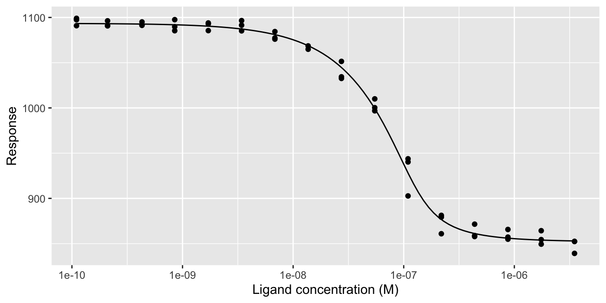

# tidymst

tidymst reads microscale thermophoresis (MST) data from NanoTemper’s
software into tidy data frames, and analyses them:

- Read MST traces, capillary scans, dose-response data and fits with
  [`read_mst()`](https://bradyajohnston.github.io/tidymst/reference/read_mst.md)
  and friends, from either the Excel files exported by MO.Affinity
  Analysis or the project files saved by MO.Control (`.moc`) and
  MO.Affinity Analysis (`.nta`). Everything is read into the same
  standard columns, with concentrations in molar.
- Recalculate Fnorm from the traces with any hot and cold windows, using
  [`mst_fnorm()`](https://bradyajohnston.github.io/tidymst/reference/mst_fnorm.md).
- Fit Kd and Hill binding models with
  [`mst_fit()`](https://bradyajohnston.github.io/tidymst/reference/mst_fit.md),
  and get the coefficients and curves with
  [`mst_coefs()`](https://bradyajohnston.github.io/tidymst/reference/mst_coefs.md)
  and
  [`mst_curve()`](https://bradyajohnston.github.io/tidymst/reference/mst_curve.md).
- Convert responses to delta Fnorm and fraction bound with
  [`mst_normalise()`](https://bradyajohnston.github.io/tidymst/reference/mst_normalise.md).
- Plot traces and dose-response curves with
  [`mst_plot_traces()`](https://bradyajohnston.github.io/tidymst/reference/mst_plot_traces.md)
  and
  [`mst_plot_dose_response()`](https://bradyajohnston.github.io/tidymst/reference/mst_plot_dose_response.md),
  or with your own ggplot2 code.

## Installation

Install the development version of tidymst from GitHub with:

``` r

# install.packages("pak")
pak::pak("BradyAJohnston/tidymst")
```

## Example

Read the MST traces exported from MO.Affinity Analysis, calculate Fnorm
for the capillaries that weren’t marked as outliers, and fit a Kd:

``` r

library(tidymst)
library(dplyr)

traces <- read_mst_traces(tidymst_example("dppr10-cy5_traces.xlsx"))

fnorm <- traces |>
  filter(included, target == "atpH-fl") |>
  mst_fnorm(hot = c(19, 20))

fits <- mst_fit(fnorm, .by = target)
mst_coefs(fits)
#> # A tibble: 4 × 7
#>   target  model term                 estimate     std_error conf_low conf_high
#>   <chr>   <chr> <chr>                   <dbl>         <dbl>    <dbl>     <dbl>
#> 1 atpH-fl kd    unbound               1.09e+3 1.74           1.09e+3   1.10e+3
#> 2 atpH-fl kd    bound                 8.52e+2 2.80           8.46e+2   8.58e+2
#> 3 atpH-fl kd    kd                    1.26e-8 0.00000000367  6.99e-9   2.27e-8
#> 4 atpH-fl kd    target_concentration  1.20e-7 0.00000000951  1.02e-7   1.40e-7
```

``` r

mst_plot_dose_response(fnorm, fits)
```



## Reading project files

You don’t need to export anything: the same functions read the project
files that NanoTemper’s software saves. An MO.Affinity Analysis project
(`.nta`) holds the raw measurements and your analysis, including which
capillaries are outliers and the fits:

``` r

project <- tidymst_example("dppr10-cy5.nta")

read_mst_dose_response(project) |>
  select(target, ligand_concentration, response, included)
#> # A tibble: 80 × 4
#>    target  ligand_concentration response included
#>    <chr>                  <dbl>    <dbl> <lgl>   
#>  1 atpH-fl        0.0000035         839. TRUE    
#>  2 atpH-fl        0.00000175        849. TRUE    
#>  3 atpH-fl        0.000000875       855. TRUE    
#>  4 atpH-fl        0.000000438       858. TRUE    
#>  5 atpH-fl        0.000000219       861. TRUE    
#>  6 atpH-fl        0.000000109       903. TRUE    
#>  7 atpH-fl        0.0000000547      997. TRUE    
#>  8 atpH-fl        0.0000000273     1034. TRUE    
#>  9 atpH-fl        0.0000000137     1065. TRUE    
#> 10 atpH-fl        0.00000000684    1076. TRUE    
#> # ℹ 70 more rows

read_mst_fit(project) |>
  select(target, model, fixed, kd, kd_std_error)
#> # A tibble: 3 × 5
#>   target   model fixed            kd kd_std_error
#>   <chr>    <chr> <chr>         <dbl>        <dbl>
#> 1 atpH-fl  hill  <NA>  NA                NA      
#> 2 atpH-fl  kd    bound  0.0000000144      2.04e-9
#> 3 NEAT1-fl kd    <NA>   0.000000434      NA
```

An MO.Control project (`.moc`) holds the measurements only, so it gives
traces and capillary scans.

See
[`vignette("tidymst")`](https://bradyajohnston.github.io/tidymst/articles/tidymst.md)
for a full walk-through, including how to make your own plots.
